

  

# GraphFrontier

GraphFrontier is an interactive graph workspace for Obsidian, with its own rendering and physics engine, independent of the built-in Graph View.

Turn connected notes into diagrams you can arrange, style, save, and share. Pin nodes in place, combine selections into named subgraphs, organize them around gravity centers, switch between layouts, and export interactive HTML graphs with note previews.

Include attachments as ordinary graph nodes, filter them by file type, and apply
selection actions to multiple nodes at once. See the [0.8.9 release notes](docs/releases/0.8.9.md).

Use it to:

- Explore connections and discover patterns in your notes
- Map systems, documentation, and database relationships
- Build reusable visual layouts for research and presentations
- Let AI agents search, arrange, and style your graph through the built-in API/MCP

[Install](#installation) · [Features](#features) · [Agent access](#api-and-ai-agent-control) · [Documentation](#documentation) · [Support](#support)

**Get started:** install GraphFrontier from Obsidian's Community plugins, then run
**Open GraphFrontier**. [Installation and updates](docs/installation.md).

## Local GraphFrontier

Open **Local GraphFrontier** from the command palette, a note's **Open linked view**
submenu, or a graph node's **Other** submenu. It follows the active note and shows
its direct neighbors, with independent settings, pins and layout state. Settings
start hidden; use **Show** to open them. Named layouts and subgraph containers
remain available in the global graph.

**Selection → Add to search** sets the modifier for adding a node name to search
(default: **Alt + click**). Name filtering keeps all same-name nodes and their
connections.

## Features

<table style="border-collapse: collapse; width: 100%;">
  <tr style="background-color: transparent;">
    <td width="50%" valign="top" align="left" style="background-color: transparent; border: none;">
      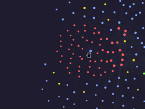
       
      
<strong>Pin nodes precisely</strong>

      
Set coordinates or drag pinned nodes without letting physics move them.

    </td>
    <td width="50%" valign="top" align="left" style="background-color: transparent; border: none;">
      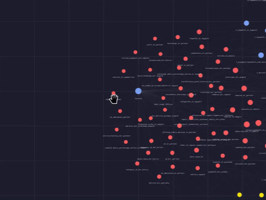
       
      
<strong>Pin nodes to the grid</strong>

      
Snap nodes to grid points and adjust grid line thickness from 0.1 to 1 pixel.

    </td>
  </tr>
  <tr style="background-color: transparent;">
    <td width="50%" valign="top" align="left" style="background-color: transparent; border: none;">
      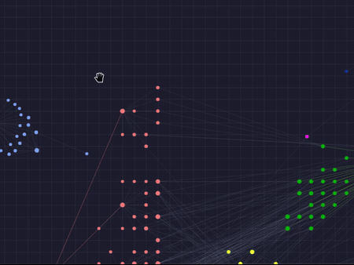
       
      
<strong>Move selected nodes together</strong>

      
Drag selected nodes together, add areas with Shift box selection, and clear selection with a plain background click.

    </td>
    <td width="50%" valign="top" align="left" style="background-color: transparent; border: none;">
      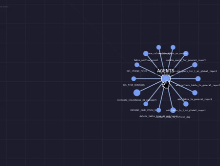
       
      
<strong>Arrange and pin linked nodes</strong>

      
Unpin linked nodes for physics to rearrange them, then pin the result to the grid.

    </td>
  </tr>
  <tr style="background-color: transparent;">
    <td width="50%" valign="top" align="left" style="background-color: transparent; border: none;">
      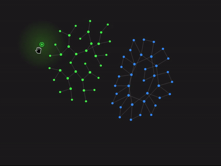
       
      
<strong>Organize notes with gravity</strong>

      
Attract free matching nodes to a movable center using name, tag, path or other queries.

    </td>
    <td width="50%" valign="top" align="left" style="background-color: transparent; border: none;">
      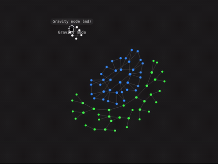
       
      
<strong>Attract matches, repel others</strong>

      
Tune attraction and repulsion separately to pull free matches closer and push nonmatches away.

    </td>
  </tr>
  <tr style="background-color: transparent;">
    <td width="50%" valign="top" align="left" style="background-color: transparent; border: none;">
      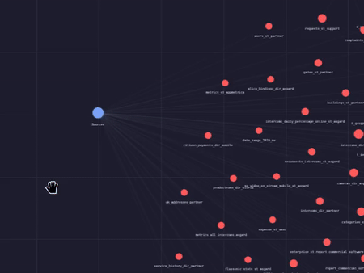
       
      
<strong>Boost a node's pull</strong>

      
Strengthen forces along existing graph links without changing note links.

    </td>
    <td width="50%" valign="top" align="left" style="background-color: transparent; border: none;">
      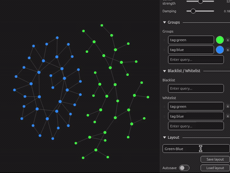
       
      
<strong>Save and switch layouts</strong>

      
Switch layouts to restore saved positions, pins, settings and camera state.

    </td>
  </tr>
  <tr style="background-color: transparent;">
    <td width="50%" valign="top" align="left" style="background-color: transparent; border: none;">
      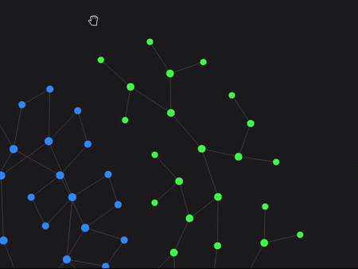
       
      
<strong>Group nodes into subgraphs</strong>

      
Name a selection and explore its contents in a separate pane with independent positions and camera.

    </td>
    <td width="50%" valign="top" align="left" style="background-color: transparent; border: none;">
      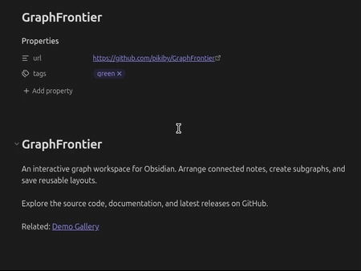
       
      
<strong>Open websites, folders, and other vaults</strong>

      
Use Open URL or Open path to visit websites, open local folders on desktop, or switch Obsidian vaults.

    </td>
  </tr>
  <tr style="background-color: transparent;">
    <td width="50%" valign="top" align="left" style="background-color: transparent; border: none;">
      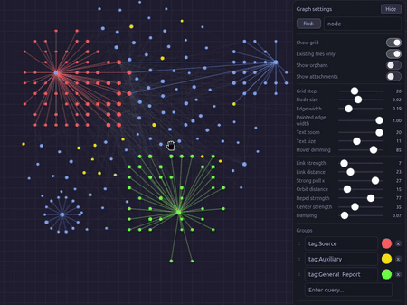
       
      
<strong>Find without hiding notes</strong>

      
Highlight search matches without hiding the rest of the graph.

    </td>
    <td width="50%" valign="top" align="left" style="background-color: transparent; border: none;">
      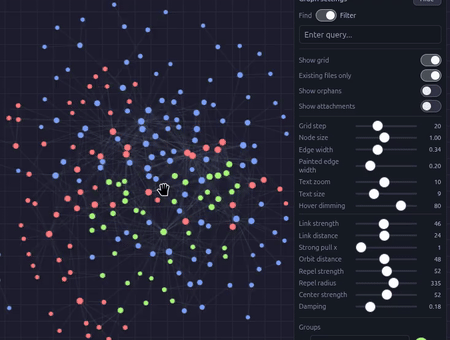
       
      
<strong>Focus with query filters</strong>

      
Name filters show a node and neighbors; tag and other queries show matches.

    </td>
  </tr>
  <tr style="background-color: transparent;">
    <td width="50%" valign="top" align="left" style="background-color: transparent; border: none;">
      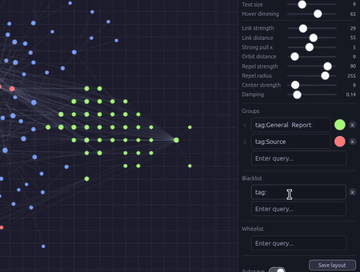
       
      
<strong>Control which notes appear</strong>

      
Hide blacklist matches or show whitelist matches without changing your notes.

    </td>
    <td width="50%" valign="top" align="left" style="background-color: transparent; border: none;">
      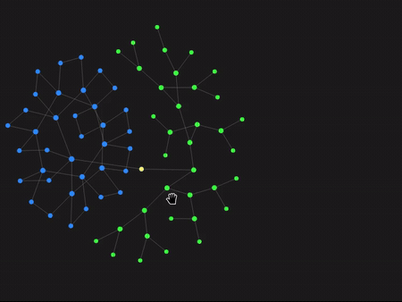
       
      
<strong>Customize individual node appearance</strong>

      
Adjust colors, sizes, auras and labels for one node or a selection.

    </td>
  </tr>
  <tr style="background-color: transparent;">
    <td width="50%" valign="top" align="left" style="background-color: transparent; border: none;">
      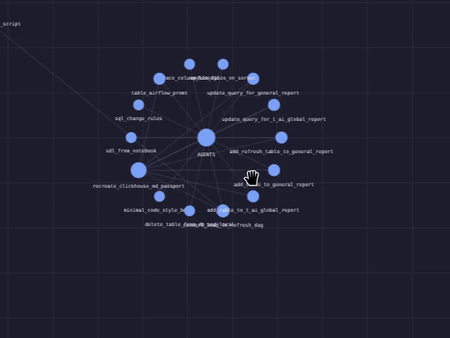
       
      
<strong>Color a node's links</strong>

      
Color a node's links and adjust their painted width separately.

    </td>
    <td width="50%" valign="top" align="left" style="background-color: transparent; border: none;">
      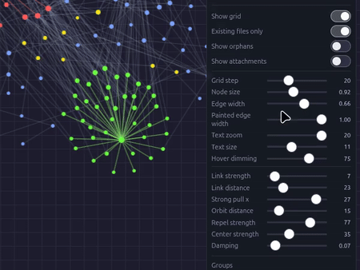
       
      
<strong>Reduce unwanted link clutter</strong>

      
Reduce regular or painted edge widths without deleting notes or changing links.

    </td>
  </tr>
  <tr style="background-color: transparent;">
    <td width="50%" valign="top" align="left" style="background-color: transparent; border: none;">
      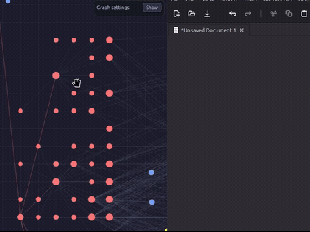
       
      
<strong>Copy linked names and paths</strong>

      
Copy names and paths from a selection or linked nodes. Ctrl+C / Cmd+C copies selected names.

    </td>
    <td width="50%" valign="top" align="left" style="background-color: transparent; border: none;">
      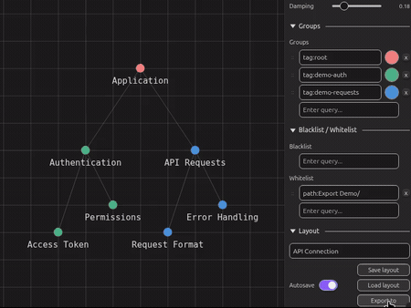
       
      
<strong>Export interactive HTML graphs</strong>

      
Export a vault-local HTML graph with note previews; review content and paths before sharing.

    </td>
  </tr>
</table>

## Attachments And Multi-Node Actions

Show linked attachments alongside notes, or enable **Show unlinked attachments**
to include other files in the vault. **Show orphans** still applies. Use the
**File type:** search field to choose multiple extensions and set an attachment
node color. These settings are saved with each layout.

Attachments use the same size and physics controls as other nodes. Their labels
include file extensions. Supported files open in Obsidian; other formats use the
system's default app where available.

Select several nodes to pin, unpin, change compatible visual settings, or copy
names and paths together. Context-menu counts show how many nodes an action will
affect; actions that require a single node remain separate.

## Groups And Node Lists

Style matching nodes with group rules. Groups change color by default; the sliders
icon opens additional controls for size, aura, labels, edge color and Strong pull.
Individual node settings take priority over group settings.

Create and edit node lists in **Settings -> GraphFrontier -> Node lists**, or use
**Add to list** on selected nodes. Use `list:<id>` as a group filter. Lists define
membership; groups define appearance. External scripts can update membership
through the API/MCP without editing your notes.

## Undo And Backups

Undo manual moves and pin actions with **Ctrl/Cmd+Z**. Redo with **Ctrl+Y** or
**Ctrl/Cmd+Shift+Z**. Physics movement, colors and other settings are not part of
this history. See [undo and redo](docs/hotkeys.md#undo-and-redo-in-the-graph).

Automatic backups keep one current copy of layouts, lists and preferences outside
the plugin folder. Configure the location, disable automatic backups or restore a
copy in **Settings -> GraphFrontier -> Backups**. Access tokens are excluded.
Existing copies are protected after reinstallation, and a temporary recovery copy
protects against interrupted writes. This does not replace backing up your vault.

## API And AI-Agent Control

GraphFrontier's built-in MCP lets an external AI agent search and work with the
open graph, arrange notes, manage subgraphs, change visual settings, and save or export layouts.
It uses the plugin's existing graph operations; it is not a separate chat or
model service.

### From A Request To A Saved Layout

In this example, an agent worked in `GraphFrontier-Demo`: it showed two tag
groups around matching gravity centers, placed green on the left and blue on
the right, added soft color auras, and saved the result as **Twin Stars**.

  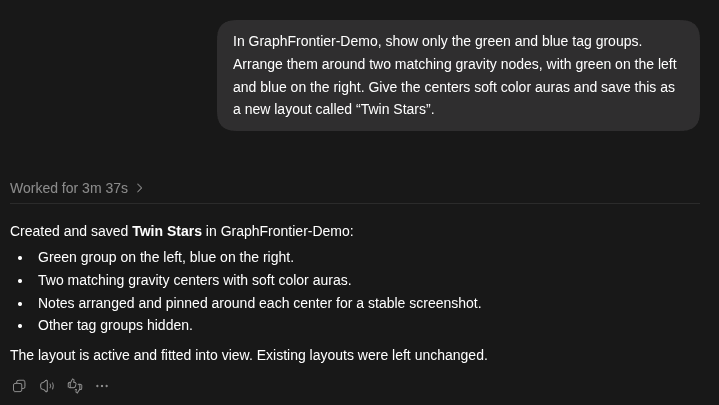

<em>The request: arrange two groups around gravity centers and save a new layout.</em>

  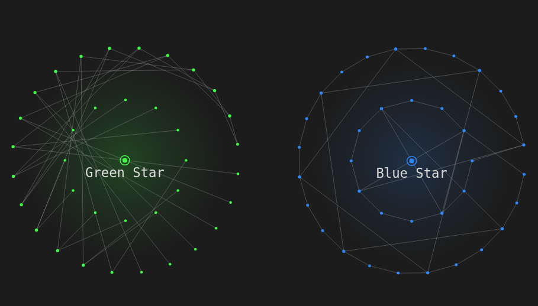

<em>The saved Twin Stars layout, with green on the left, blue on the right, and other groups hidden.</em>

An MCP-capable agent can:

- Search and filter notes, and work with groups, blacklists and whitelists.
- Arrange and pin nodes, tune physics, and create or position gravity centers.
- Create and rename subgraphs, open their panes, or ungroup their members.
- Change global, group or individual visual settings, including colors, sizes and auras.
- Create node lists and update membership to drive group styles.
- Create and switch layouts, make backups, and export interactive HTML graphs.

### Connect A Client

1. In desktop Obsidian, enable **Settings -> GraphFrontier -> Local MCP**.
2. Add the settings-provided endpoint and token configuration to an MCP-capable client, such as Codex, Claude Code or OpenCode. See [client configurations](docs/mcp.md#client-configurations).
3. Open a graph and ask the agent to identify the vault before making changes.

### Safety And Current Limits

MCP is off by default and desktop-only. It runs as a local authenticated server.
Only connect trusted clients: they can change layouts and export note content,
and data returned to the client may be sent to its AI provider. GraphFrontier
includes no built-in model or AI subscription. See the [full tool and API
reference](docs/mcp.md#tools-and-internal-api) for details.

## Installation

### Community Plugins (Recommended)

1. Open Obsidian's **Settings -> Community plugins** and enable community plugins if needed.
2. Select **Browse**, search for **GraphFrontier**, then select **Install** and **Enable**.
3. Run **Open GraphFrontier** from the command palette or use its ribbon icon.

[Open the Community directory listing](https://community.obsidian.md/plugins/graphfrontier).
No separate Node.js installation is needed. For updates, use **Check for updates** in Community plugins.

### Manual Installation

Download `main.js`, `manifest.json` and `styles.css` from the [latest release](https://github.com/pikiby/GraphFrontier/releases/latest) into `<vault>/.obsidian/plugins/graphfrontier/`, then enable GraphFrontier in `Settings -> Community plugins`.

When updating, replace the plugin files, not the entire folder: keep your
`data.json`, `layouts/`, `node-lists.json` and optional `mcp.json`. Reload the plugin afterward.

See the [installation guide](docs/installation.md) for source builds and troubleshooting.

## Compatibility And Privacy

- Obsidian 1.12.7 or newer; graph works on desktop and mobile. Tested on Android 11 hardware and an Android 15 emulator with Obsidian 1.14.4; iOS is unverified, and touch box selection is unavailable.
- External-file navigation is desktop-only.
- GraphFrontier reads vault notes and metadata to build the graph; copy actions write to the clipboard.
- HTML export stays inside the vault and can include note contents and paths; inspect exports before sharing.
- Large-graph performance depends on graph size, enabled effects and device.

## Documentation

- **Getting started:** [Installation](docs/installation.md), [Usage](docs/usage.md), [Settings](docs/settings.md).
- **Advanced:** [Hotkeys and commands](docs/hotkeys.md), [Physics model](docs/physics.md), [Local API and embedded MCP](docs/mcp.md), [Development and project structure](docs/development.md).
- **Help:** [Troubleshooting](docs/troubleshooting.md), [Release notes for 0.8.9](docs/releases/0.8.9.md), [release history](docs/releases/).

## Support

I would be grateful for your support, ideas and bug reports.

[Share an idea](https://github.com/pikiby/GraphFrontier/discussions) · [Report a bug](https://github.com/pikiby/GraphFrontier/issues)

## License

MIT. See `LICENSE`.
