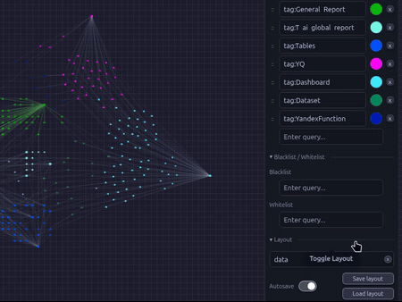
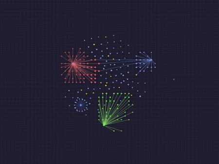
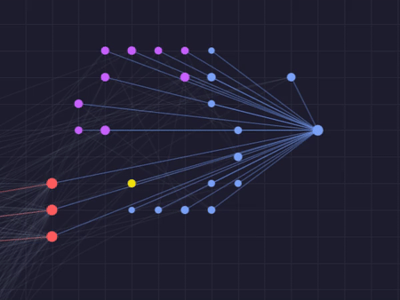
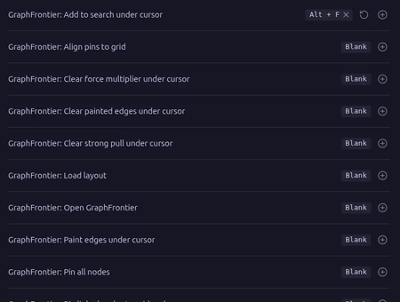
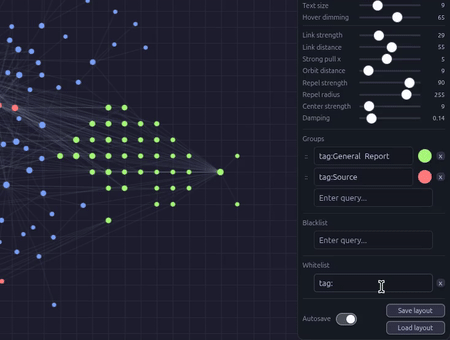

# GraphFrontier

GraphFrontier is **not** a plugin for Obsidian Graph View.
It is a fully independent plugin with its own physics engine, designed to implement ideas that are not possible in the standard graph plugin.

The main goal is to build an ideal, universal data-visualization tool that keeps the strengths of Graph View while removing its limitations.

It helps create a clean, well-organized structure for large collections of notes and stays very smooth even with a very large number of objects.

Especially useful for:

- Finding patterns
- Documentation
- Visualizing relationships in database structures
- Prompt engineering

## Support

This project is actively growing, and I would be very grateful for your support.

I would be happy to hear your ideas:

https://github.com/pikiby/GraphFrontier/discussions

And I would really appreciate your help with bug reports:

https://github.com/pikiby/GraphFrontier/issues

## Installation

Download:

https://github.com/pikiby/GraphFrontier/releases/download/0.8.0/graphfrontier-0.8.0.zip

1. Download `graphfrontier-0.8.0.zip` from Releases.
2. Extract it into `<vault>/.obsidian/plugins/graphfrontier/`.
3. Enable it in `Settings -> Community plugins -> GraphFrontier`.

When updating, replace the plugin files, not the entire folder: keep your
`data.json`, `layouts/` and optional `mcp.json`. Reload the plugin afterward.

## Recent Updates (0.8.0)

Changes since **0.7.7**:

- **Embedded API and MCP:** 32 tools let a connected agent inspect and control the graph, settings, individual nodes, filters, gravity centers, layouts, backups and HTML exports.
- **One plugin, no separate server process:** optional authenticated localhost access, with setup examples for Codex, Claude Code and OpenCode 1.x.
- **Layout automation and recovery:** create, switch, save, back up, delete and restore layouts. MCP saves, deletions and replacement restores preserve the previous saved file first.
- **More complete snapshots:** save and restore camera position/zoom, search state and an exact node subset alongside existing positions and settings.
- **Targeted HTML export:** export a specific set of nodes and their internal links, choose whether to embed note previews, and require explicit permission to overwrite an existing file.
- **Pinning fix:** fixed nodes keep repelling free nodes. Pinning constrains position rather than removing influence; link attraction and Strong pull are preserved.
- **Persistence fixes:** serialize layout switching/deletion with saves, validate the fallback before deleting an active layout, and preserve attachment link distance `1` across reloads.

[Read the detailed release notes](docs/releases/0.8.0.md) or
[compare 0.7.7 with 0.8.0](https://github.com/pikiby/GraphFrontier/compare/0.7.7...0.8.0).

## API And AI-Agent Control

GraphFrontier now exposes the graph as an actionable workspace, not just a
picture. A connected agent can inspect existing relationships, construct a
focused layout, style and arrange its nodes, save it and export an interactive
HTML diagram. It uses the plugin's existing operations rather than editing
layout JSON behind Obsidian's back.

There are two layers: a JavaScript API on the loaded plugin instance and an
optional **Model Context Protocol (MCP)** server exposing that same API to
external clients. The HTTP endpoint speaks MCP, not a separate REST API.

### What An Agent Can Do

| Area                  | Available controls                                                                                                                                                                                                     |
| --------------------- | ---------------------------------------------------------------------------------------------------------------------------------------------------------------------------------------------------------------------- |
| Inspect the graph     | Identify the vault and open graph tabs; read paginated nodes, edges, selection, active layout, camera, global settings and effective individual settings.                                                              |
| Search and filter     | Search by name, vault path, filename, tag, line, section or property; change Find/Filter mode; highlight explicit nodes and optionally neighbors; show an exact node subset with only its internal links.              |
| Groups and lists      | Add, edit, enable/disable, remove, reorder or clear Groups, Blacklist and Whitelist rules; set group colors.                                                                                                           |
| Appearance            | Change global and individual node colors/sizes, labels, edge widths, painted edges, hover dimming and color auras; reset individual overrides to inheritance.                                                          |
| Physics and placement | Set physics parameters, pause/resume simulation, move nodes, pin exactly or to the grid, arrange linked nodes or attachments on orbits, unpin, align pins and move/fit the camera.                                     |
| Gravity centers       | Create, edit or remove gravity nodes, their typed query rules, names, positions, attraction and repulsion.                                                                                                             |
| Layouts and recovery  | List, create, copy, switch, save and delete layouts; control autosave; create/list backups and restore them into the original or a different layout.                                                                   |
| Export                | Discover export locations and write a standalone HTML graph from current visibility or explicit node IDs, with optional Markdown previews and explicit overwrite control.                                              |
| UI and node actions   | Select/clear nodes, select linked nodes, arm box selection, show/hide the panel, collapse sections, configure command hotkeys, copy names/paths/links, open notes and supported destinations, and show/close previews. |

The [API reference](docs/mcp.md#tools-and-internal-api) lists all **32 tools**,
their methods, validation rules, pagination and state handling.

### Connect A Client

MCP is **off by default** and **desktop-only**. GraphFrontier's existing mobile
graph remains available without a listener or Node.js imports.

1. Open `Settings -> GraphFrontier -> Local MCP` and enable MCP.
2. Copy the generated access token. Use a different port for each vault if several are open; the default is `27125`.
3. Set `GRAPHFRONTIER_MCP_TOKEN` in the environment that launches your client, then merge the matching configuration from the settings page or [connection guide](docs/mcp.md#client-configurations).
4. Connect the client to `http://127.0.0.1:27125/mcp`. Open GraphFrontier, or explicitly ask the agent to open it, and have it identify the vault with `list_views` before changing anything.

Configuration examples are provided for **Codex**, **Claude Code** and
**OpenCode 1.x**. They use Streamable HTTP with Bearer authentication; check the
guide for version-specific compatibility and clients that cannot reach localhost.
No additional GraphFrontier service, npm setup or separately installed Node.js
is needed by users. MCP uses desktop Obsidian's embedded runtime, which must
provide Node 18+ and Web Fetch APIs.

The server follows the enabled plugin's lifecycle, not a graph tab: closing the
tab does not stop it; disabling MCP/the plugin or closing Obsidian does.

### Example Requests

After connecting an agent, you can ask for workflows such as:

- "Create a layout called Architecture from the current graph. Show only notes tagged architecture and their direct neighbors, pin them to the grid, and save it."
- "Make these selected nodes yellow, increase their labels, and give them a soft color aura. Leave other nodes unchanged."
- "Create a gravity node for `tag:backend`, set its attraction to 15 and repulsion to 5, and move it to the left of the diagram."
- "Ensure the saved Architecture layout has a backup. Turn autosave off, adjust the physics, then restore the backup if I ask."
- "Export these notes and only their internal links to my desktop as architecture.html, without embedding note text."

These are examples for an MCP-capable agent, not a new built-in chat or prompt
box. GraphFrontier does not supply an AI model or an agent subscription.

### Safety And Current Limits

The listener binds only to `127.0.0.1`, requires a token, validates Host/Origin
and limits request sizes/rates. It is not exposed to the LAN or internet.
Only connect trusted clients: the token grants access to the graph-control
tools, including layout changes and explicit filesystem exports. It is not a
read-only credential. Data returned to an AI client may subsequently be sent
to that client's model provider under the client's own settings.

MCP credentials are stored separately in `mcp.json`, never in a saved layout.
Do not publish that file. Blacklist/Whitelist are visual filters, not permission
boundaries; an authorized client can request hidden node metadata.

Mutations use a graph/view context token and reject stale state after a layout
switch or graph rebuild. MCP writes are queued, and saved-layout backups are
verified before replacement or deletion. Autosave still follows the selected
layout's setting. These backups are local recovery copies, not protection from
disk failure.

Important boundaries:

- Node IDs are vault-relative paths. Real filesystem paths, especially linked external folders, are **not automatically resolved** to node IDs yet; verify a candidate with `node_action` / `copy_system_path`.
- MCP `save_layout` can capture a nonempty search. The manual Save button and normal autosave still retain their existing nonempty-search restriction.
- HTML export includes note previews by default; use `includeContents: false` to omit them. Paths and other metadata can still be present, so inspect exports before sharing.
- No arbitrary JavaScript execution, generic note editing, vault-file deletion or third-party/native menu callbacks such as merging and bookmarking are exposed. MCP credentials and server controls remain in local settings.
- Schemas normally limit explicit node batches to 500; larger graph reads are paginated. The [full reference](docs/mcp.md) documents each limit and error behavior.

For implementation details, setup examples and a complete subgraph-export
workflow, see [Local Graph API and MCP](docs/mcp.md).

## Features

<table style="border-collapse: collapse; width: 100%;">
  <tr style="background-color: transparent;">
    <td width="50%" valign="top" align="left" style="background-color: transparent; border: none;">
      
       
      
<strong>Pin nodes exactly where you want them</strong>

    </td>
    <td width="50%" valign="top" align="left" style="background-color: transparent; border: none;">
      
       
      
<strong>Pin nodes to the grid</strong>

    </td>
  </tr>
  <tr style="background-color: transparent;">
    <td width="50%" valign="top" align="left" style="background-color: transparent; border: none;">
      
       
      
<strong>Save node positions and keep your layout exactly where you want it every time you open the graph</strong>

    </td>
    <td width="50%" valign="top" align="left" style="background-color: transparent; border: none;">
      
       
      
<strong>Boost attraction to a specific node</strong>

    </td>
  </tr>
  <tr style="background-color: transparent;">
    <td width="50%" valign="top" align="left" style="background-color: transparent; border: none;">
      
       
      
<strong>Place linked nodes on another node orbit with one click</strong>

    </td>
    <td width="50%" valign="top" align="left" style="background-color: transparent; border: none;">
      
       
      
<strong>Move linked nodes and keep them exactly where you need them</strong>

    </td>
  </tr>
  <tr style="background-color: transparent;">
    <td width="50%" valign="top" align="left" style="background-color: transparent; border: none;">
      
       
      
<strong>Paint links for better visual clarity</strong>

    </td>
    <td width="50%" valign="top" align="left" style="background-color: transparent; border: none;">
      
       
      
<strong>Hide links you do not need</strong>

    </td>
  </tr>
  <tr style="background-color: transparent;">
    <td width="50%" valign="top" align="left" style="background-color: transparent; border: none;">
      
       
      
<strong>Find mode explore links in the full context</strong>

    </td>
    <td width="50%" valign="top" align="left" style="background-color: transparent; border: none;">
      
       
      
<strong>Filter mode local graph behavior directly in the global view</strong>

    </td>
  </tr>
  <tr style="background-color: transparent;">
    <td width="50%" valign="top" align="left" style="background-color: transparent; border: none;">
      
       
      
<strong>Orphan files stay separate from primary nodes</strong>

    </td>
    <td width="50%" valign="top" align="left" style="background-color: transparent; border: none;">
      
       
      
<strong>Show only linked attachments and place them directly on node orbits</strong>

    </td>
  </tr>
  
  <tr style="background-color: transparent;">
    <td width="50%" valign="top" align="left" style="background-color: transparent; border: none;">
      
       
      
<strong>Hotkey support</strong>

    </td>
    <td width="50%" valign="top" align="left" style="background-color: transparent; border: none;">
      
       
      
<strong>Copy linked names and paths in one click</strong>

    </td>
  </tr>
  <tr style="background-color: transparent;">
    <td width="50%" valign="top" align="left" style="background-color: transparent; border: none;">
      
       
      
<strong>Hide unnecessary objects</strong>

    </td>
    <td width="50%" valign="top" align="left" style="background-color: transparent; border: none;">
      
       
      
<strong>Keep only necessary objects</strong>

    </td>
  </tr>
</table>

## Documentation

- Installation: `docs/installation.md`
- Usage: `docs/usage.md`
- Settings: `docs/settings.md`
- Hotkeys and commands: `docs/hotkeys.md`
- Physics model: `docs/physics.md`
- Troubleshooting: `docs/troubleshooting.md`
- Local API and embedded MCP: [setup, tool reference and automation examples](docs/mcp.md)

## Project Structure

- `src/main.js`: plugin core, persistence, graph data collection, commands registration
- `src/view.js`: view lifecycle, UI, interactions, context actions, runtime orchestration
- `src/physics.js`: simulation and orbit-related calculations
- `src/render.js`: render pass, visual helpers, focus/label/color behavior
- `src/constants.js`: defaults, limits, command metadata, shared constants
- `src/api.js`, `src/api-actions.js`, `src/api-layouts.js`, `src/api-tools.js`: graph API, actions, layout recovery and validated schemas
- `src/mcp-server.js`, `src/mcp-settings.js`: optional authenticated MCP transport and connection settings
- `src/static/`: plugin release assets source (`manifest.json`, `styles.css`, `versions.json`)
- `dist/`: built plugin files ready to install into a vault plugin folder
- `dist/release/`: packaged release zip files

## License

MIT. See `LICENSE`.
